# Inflammatory and Immune Related Gene Expression Changes in Neutrophils Following Endurance Exercise

A bioinformatics re-analysis of the public GEO dataset **GSE43856** using R (limma and clusterProfiler).

## 1. Introduction

Endurance exercise triggers physiological and molecular responses, including changes in immune activity, inflammation and cellular metabolism. These responses involve changes in the expression of many genes.

This project analyses circulating **neutrophil (blood PMN)** gene expression before and after a bout of endurance exercise, using publicly available microarray data from the Gene Expression Omnibus (GEO). The workflow covers exploratory data analysis, PCA, sample correlation, differential expression, probe-to-gene annotation, Gene Ontology (GO) enrichment, KEGG pathway enrichment and a follow-up analysis of ten selected immune-related genes.

## 2. Research Objectives

- Obtain and prepare publicly available gene expression data related to endurance exercise.
- Explore expression patterns using exploratory data analysis, PCA and sample correlation.
- Identify differentially expressed probes at 3, 48 and 96 hours after exercise, each compared with baseline.
- Annotate probes with gene symbols, Entrez IDs and descriptions.
- Identify enriched biological processes (GO) and pathways (KEGG).
- Examine selected immune-related genes and compare their behaviour across time points.

## 3. Dataset

| Item | Detail |
|---|---|
| Accession | [GSE43856](https://www.ncbi.nlm.nih.gov/geo/query/acc.cgi?acc=GSE43856) |
| Platform | GPL10558, Illumina HumanHT-12 V4.0 Expression BeadChip |
| Organism | *Homo sapiens* |
| Participants | 8 healthy, endurance-trained men |
| Exercise trial (EXTRI) | 1 hour of cycling followed by 1 hour of running |
| Tissues in GEO series | Blood PMN (neutrophils) and skeletal muscle, 64 samples in total |
| Samples used here | **32 blood PMN samples** (8 per time point) |

Time points analysed: **baseline (pre-exercise), 3 h, 48 h and 96 h** after exercise. Skeletal muscle samples were excluded.

According to the GEO record, the data were background-corrected in GenomeStudio and quantile-normalised with the Bioconductor `lumi` package. No additional normalisation was applied in this project.

## 4. Methodology

All analyses were done in R / RStudio.

### 4.1 Data preparation (`01_data_preparation.R`)
The series matrix (`GSE43856_series_matrix.txt.gz`) was loaded with `GEOquery`. Sample metadata were inspected, and the 32 samples with `tissue = blood PMN` were selected. The expression matrix has 47,323 probes.

### 4.2 Exploratory data analysis
A boxplot of expression values across all 32 samples was produced to check consistency between samples.

### 4.3 PCA (`02_PCA_analysis.R`)
PCA was run on the 500 most variable probes (`prcomp`, centred, not scaled) and samples were coloured by time point.

### 4.4 Sample correlation (`03_sample_correlation.R`)
A sample-by-sample correlation matrix was visualised as a clustered heatmap.

### 4.5 Differential expression (`05_differential_expression.R`)
Differential expression used **limma**:

- Design: a cell-means model (`~ 0 + time_point`) with groups Baseline, H3, H48 and H96.
- Because each participant was measured at all four time points, repeated measures were handled with `duplicateCorrelation()`, using participant as the block.
- Contrasts: 3 h − baseline, 48 h − baseline, 96 h − baseline.
- Empirical Bayes moderation (`eBayes`), Benjamini-Hochberg adjustment, significance at adjusted p < 0.05.
- Volcano plots show −log10 p-value against log2 fold change. Dashed lines mark p = 0.05 and |log2FC| = 1; the significance colouring is by adjusted p < 0.05.

### 4.6 Probe-to-gene annotation (`06_probe_gene_annotation.R`)
Probes were mapped to gene symbol, Entrez Gene ID and definition using the Illumina HumanHT-12 V4 annotation file (`GPL10558_..._R2`).

### 4.7 GO enrichment (`07_GO_enrichment.R`)
`enrichGO` (clusterProfiler, `org.Hs.eg.db`), Biological Process ontology, BH-adjusted p < 0.05 and q < 0.20. The **universe** was all tested genes with a valid Entrez ID. Analyses were run for all significant genes and separately for upregulated and downregulated genes.

### 4.8 KEGG enrichment (`08_KEGG_enrichment.R`)
`enrichKEGG` (organism `hsa`), same universe and cut-offs as GO.

### 4.9 Immune-related genes (`08_KEGG_enrichment.R`, `09_immune_gene_time_comparison.R`)
Ten genes from the enriched *Th1 and Th2 cell differentiation* pathway were examined: **RUNX3, CD247, CD3D, STAT4, NFATC1, PPP3CC, IL2RB, MAPK14, HLA-DRA, HLA-DMB**.

- At 3 h, the most significant probe per gene was used (`Immune_related_genes_3h.csv`).
- For the 3 h / 48 h / 96 h comparison, the **median logFC across all probes** of each gene was used (`Immune_gene_time_comparison.csv`). Because of this, a few 3 h values differ slightly between the two analyses (for example MAPK14: 1.24 vs 1.05).

## 5. Results

### 5.1 Exploratory analysis

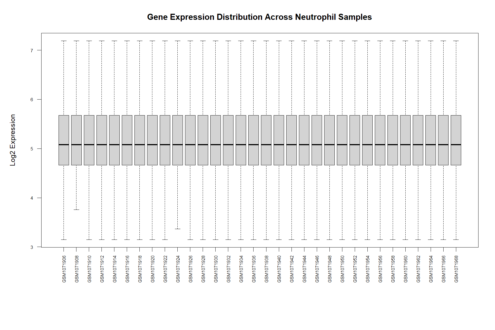

The boxplots are almost identical across samples, as expected after quantile normalisation. The only visible differences are the lower whiskers of GSM1071908 and GSM1071924, the same two samples that stand out in the PCA and correlation heatmap below.

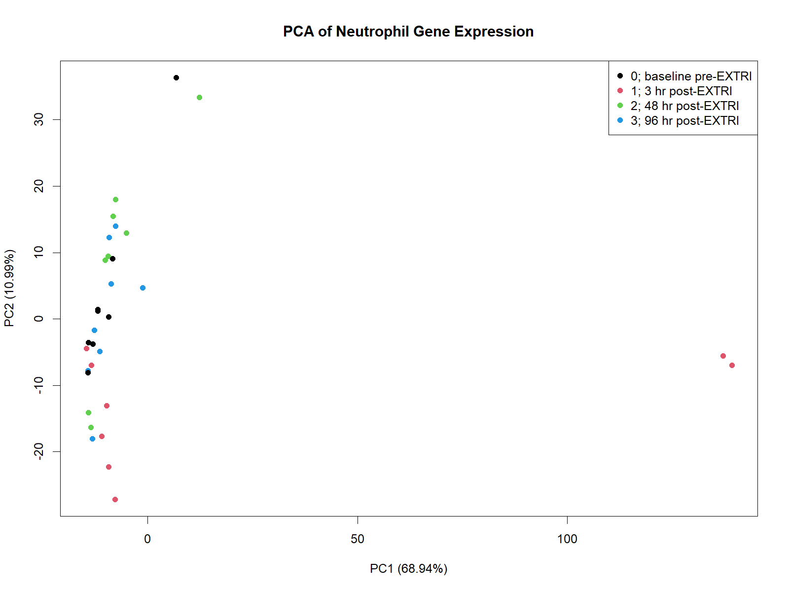

PC1 explains 68.94% and PC2 10.99% of the variance. **PC1 is driven almost entirely by two samples**, both from the 3 h time point. The remaining samples cluster tightly, and baseline, 48 h and 96 h samples overlap.

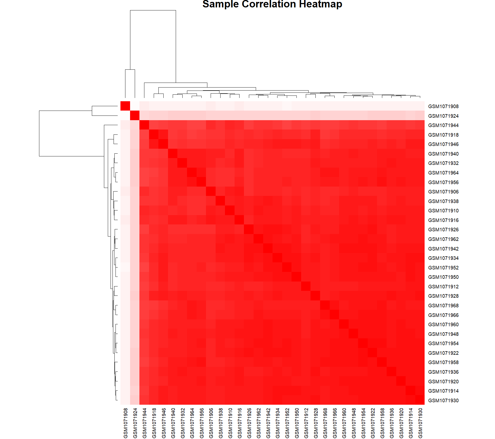

The heatmap confirms the same picture: most samples are highly correlated with each other, while two samples (GSM1071908, participant 1, and GSM1071924, participant 3, both 3 h post-exercise) correlate much less with the rest. These are the likely PCA outliers. Their effect on the 3 h results was not tested (see Limitations).

### 5.2 Differential expression

| Comparison | Probes tested | Significant probes (adj. p < 0.05) | Up | Down |
|---|---|---|---|---|
| 3 h vs baseline | 47,323 | **565** | 44 | 521 |
| 48 h vs baseline | 47,323 | **0** | 0 | 0 |
| 96 h vs baseline | 47,323 | **0** | 0 | 0 |

The 565 significant probes correspond to **545 unique gene symbols**. These are probe-level counts, so some genes are represented by more than one probe. No probes were significant at 48 h or 96 h after multiple-testing correction.

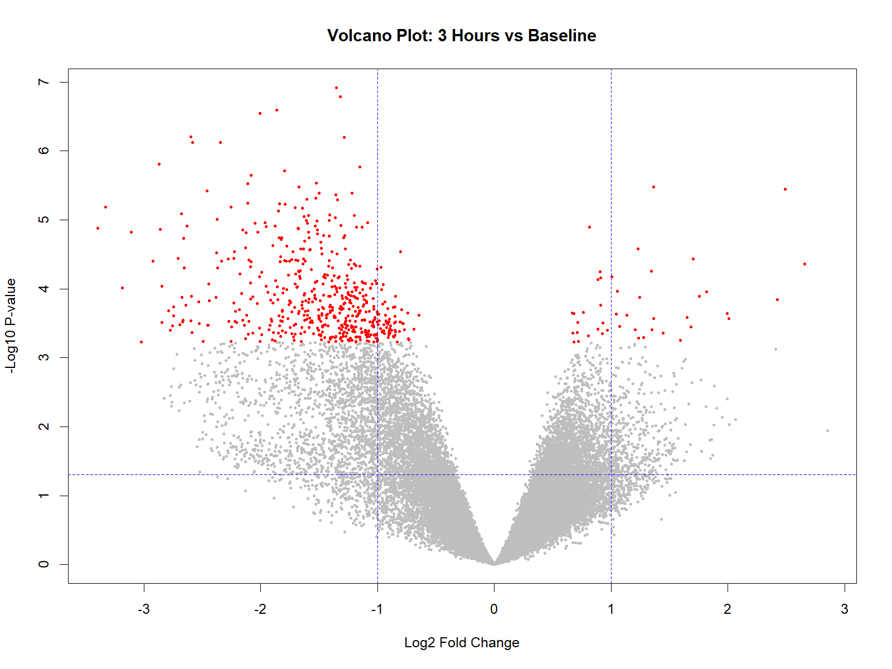

At 3 h, most significant changes are decreases in expression.

| 48 h vs baseline | 96 h vs baseline |
|---|---|
| 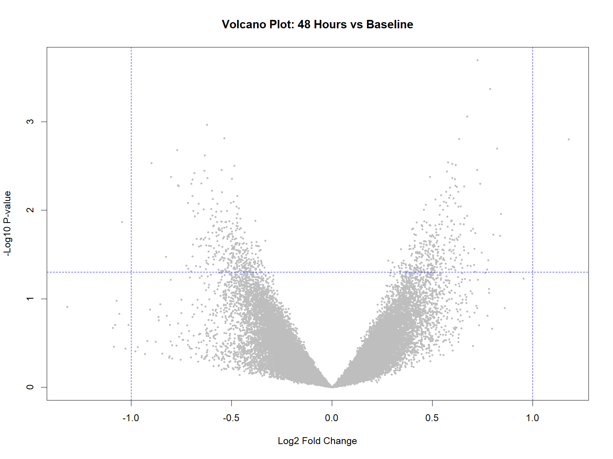 | 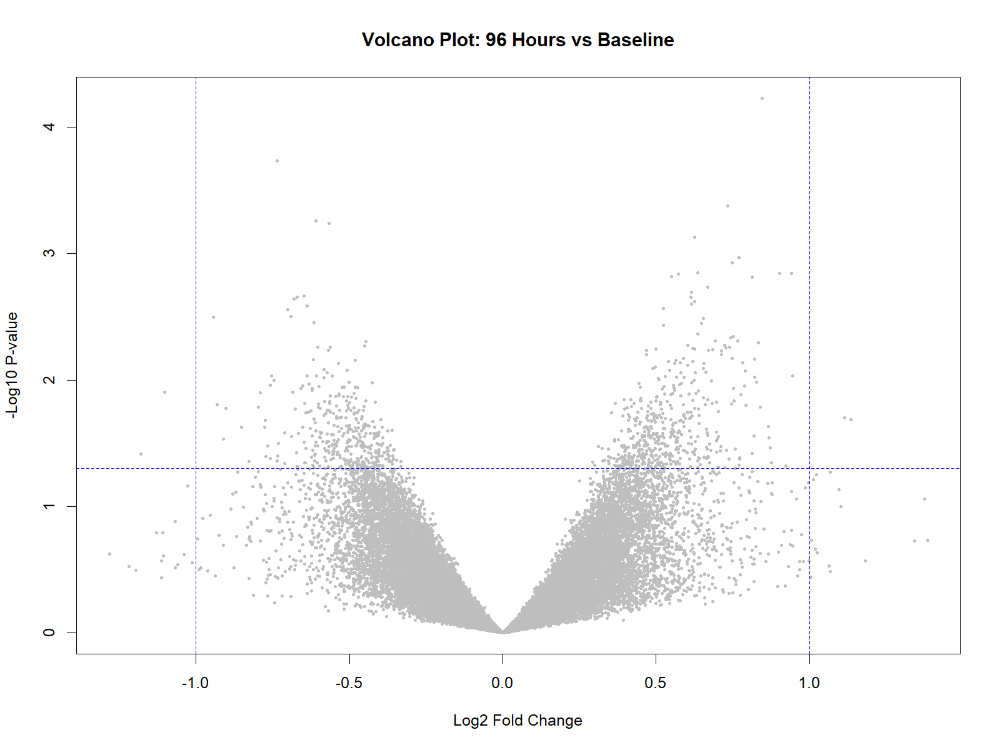 |

### 5.3 GO Biological Process enrichment (3 h)

Of the significant probes, 540 unique Entrez IDs were used for enrichment (44 up, 496 down). GO enrichment gave **50 significant terms**, among them T cell activation, alpha-beta T cell activation, tRNA metabolic process, tRNA processing, mitochondrial gene expression, RNA modification, ribosome biogenesis and adaptive immune response.

Separate analyses gave **45 enriched terms for downregulated genes** and **none for upregulated genes**.

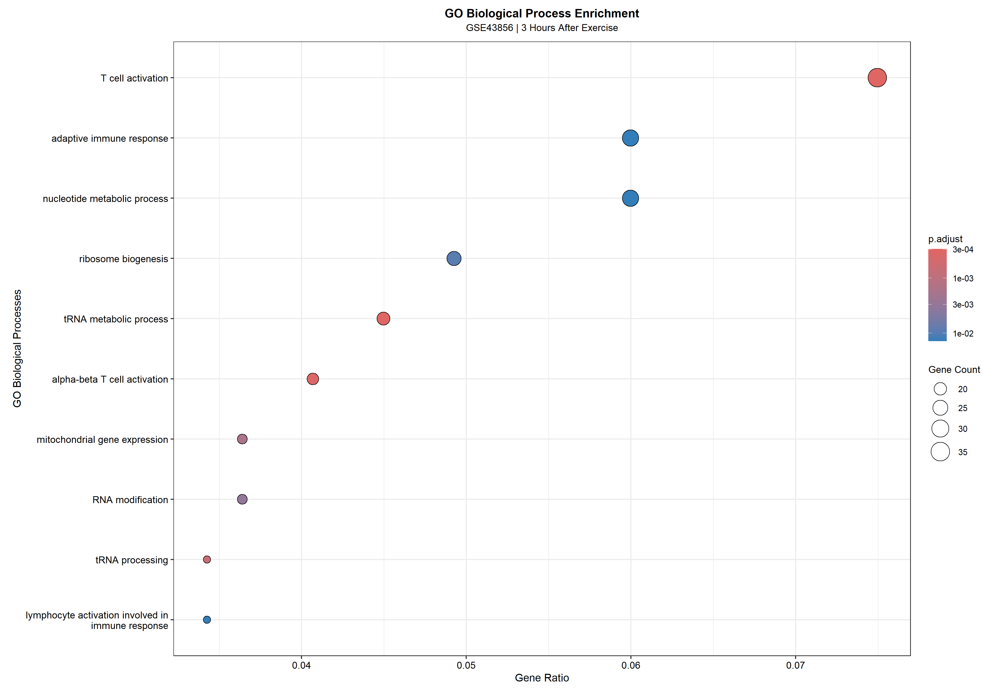

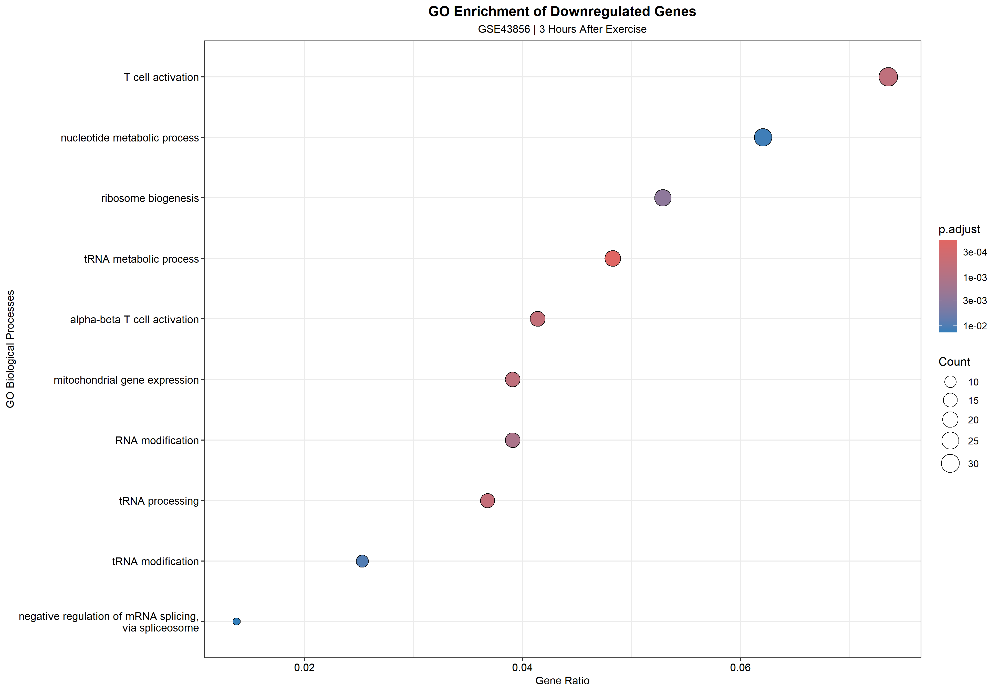

### 5.4 KEGG pathway enrichment (3 h)

Eight pathways were significant (adjusted p < 0.05):

1. Ribosome biogenesis in eukaryotes
2. Base excision repair
3. Prion disease
4. Amyotrophic lateral sclerosis
5. Th1 and Th2 cell differentiation
6. Aminoacyl-tRNA biosynthesis
7. Spliceosome
8. Carbon metabolism

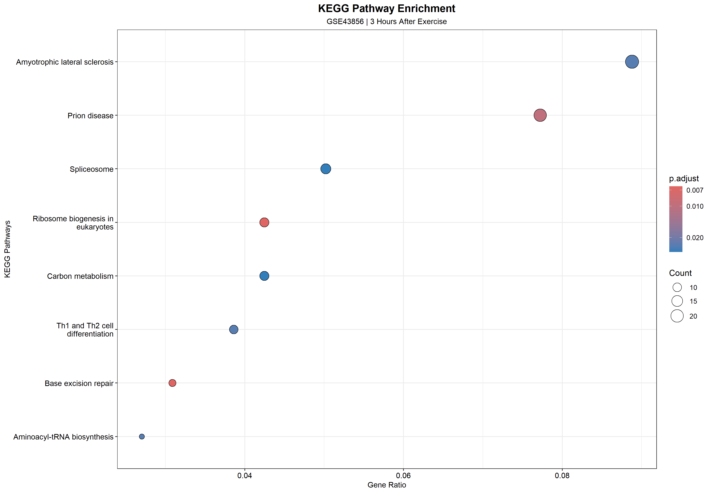

The pathways cover RNA processing, protein synthesis, DNA repair, metabolism and immune-related functions. Disease-named pathways (prion disease, ALS) do not imply that participants had those diseases; they share genes involved in general cellular processes such as mitochondrial function and proteasome activity.

### 5.5 Selected immune-related genes at 3 h

All ten genes were significant at 3 h (adjusted p < 0.05, using each gene's most significant probe). Eight were downregulated: RUNX3, CD247, CD3D, STAT4, PPP3CC, IL2RB, HLA-DRA and HLA-DMB. Two were upregulated: NFATC1 and MAPK14.

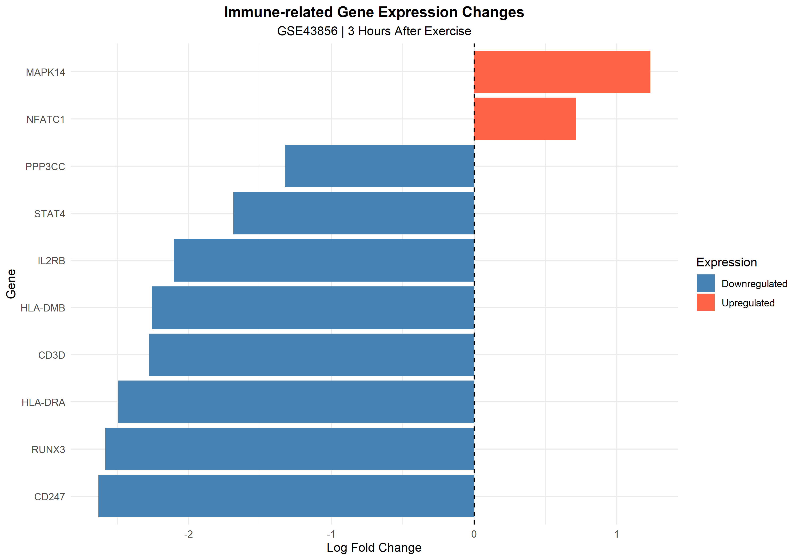

### 5.6 Comparison across time points

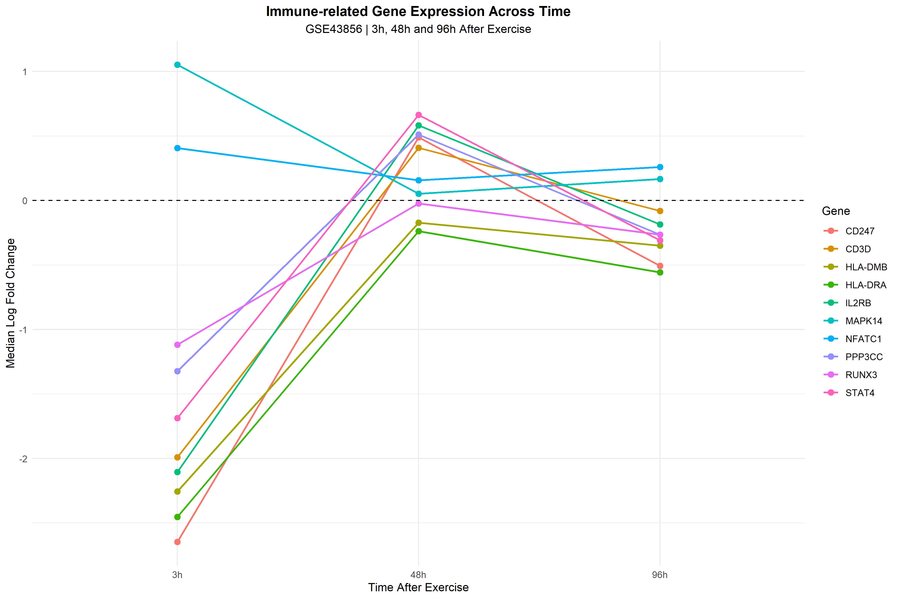

Median logFC values are close to zero at 48 h and 96 h for all ten genes, and none was significant at either time point (there were no significant probes at all at those time points). This suggests the 3 h changes were transient, but time points were each compared only with baseline and not with each other, so a return to baseline cannot be statistically established.

## 6. Discussion

Endurance exercise was associated with a clear change in neutrophil gene expression at 3 hours, mostly decreased expression, that was no longer detectable at 48 and 96 hours.

The GO and KEGG results highlight immune-related annotations (T cell activation, adaptive immune response, Th1/Th2 differentiation) alongside RNA processing, tRNA metabolism, ribosome biogenesis and mitochondrial gene expression. Some caution is needed:

- The samples are **neutrophils**, not isolated T cells. Enrichment of T-cell-annotated terms means that genes annotated to those terms changed, and does not show that T-cell differentiation changed. It may also reflect the contribution of other cells, or shared genes (for example HLA-DR, CD3 or calcineurin pathway genes).
- GO and KEGG enrichment show **over-representation** of annotations among changed genes. They do not show whether a process is activated or suppressed.
- The original study (Neubauer et al., 2013) reported upregulated innate immune signalling (TLR, IL-1 and tissue-damage-related gene sets) at 3 h using gene set enrichment analysis. This project used a different approach (thresholded probe-level testing followed by over-representation analysis) and found mainly downregulated genes, so the two analyses are not directly comparable.

## 7. Limitations

1. **Small sample size:** 8 participants, all trained men, limiting power and generalisability.
2. **Possible outlier samples:** two 3 h samples (GSM1071908, GSM1071924) differ strongly from all others in PCA and correlation. The 3 h results were not re-run without them or with outlier-robust weighting, so they may influence the 3 h findings.
3. **Single cell type:** only neutrophils were analysed.
4. **Probe-level analysis:** several probes can map to one gene.
5. **RNA is not protein:** expression changes do not necessarily reflect changes in protein levels or activity.
6. **Enrichment interpretation:** over-representation is not direct evidence of pathway activation or suppression.
7. **Time-point comparisons:** each time point was tested against baseline only, with no direct tests between 3 h, 48 h and 96 h.
8. **Selected genes:** the immune analysis covers ten genes chosen from one pathway and is not exhaustive.
9. **No validation:** results were not validated by qPCR or an independent dataset.

## 8. Conclusion

Using GSE43856, this project found 565 significant probes (545 genes) in circulating neutrophils 3 hours after endurance exercise, mostly downregulated, and none at 48 or 96 hours. GO enrichment identified 50 biological processes and KEGG identified eight pathways at 3 hours, with immune-related, RNA-processing and metabolic terms. Ten selected immune-related genes were all significant at 3 hours and showed no significant change at later time points. The findings suggest an early, transient transcriptional response in neutrophils, to be interpreted with caution given the small sample size, two outlying samples and the limits of enrichment analysis.

## 9. Tools

| Tool | Use |
|---|---|
| R, RStudio | Analysis environment |
| GEOquery | Loading GEO data |
| limma | Differential expression |
| clusterProfiler, enrichplot, org.Hs.eg.db | GO / KEGG enrichment and annotation |
| ggplot2, tidyverse | Data handling and plots |
| Git / GitHub | Version control |

## 10. Repository Structure

```text
Bioinformatics/
├── Scripts/
│   ├── 01_data_preparation.R
│   ├── 02_PCA_analysis.R
│   ├── 03_sample_correlation.R
│   ├── 04_metadata_check.R
│   ├── 05_differential_expression.R
│   ├── 06_probe_gene_annotation.R
│   ├── 07_GO_enrichment.R
│   ├── 08_KEGG_enrichment.R
│   └── 09_immune_gene_time_comparison.R
├── data/
│   └── raw/            # GSE43856 series matrix + GPL10558 annotation files
├── figures/            # 01–11 PNG figures shown above
├── results/            # DEG, annotated DEG, GO, KEGG and immune-gene CSV files
└── README.md
```

## 11. References

1. Neubauer O, Sabapathy S, Lazarus R, Jowett JBM, Desbrow B, Peake JM, Cameron-Smith D, Haseler LJ, Wagner KH, Bulmer AC (2013). Transcriptome analysis of neutrophils after endurance exercise reveals novel signaling mechanisms in the immune response to physiological stress. *Journal of Applied Physiology*, 114(12), 1677–1688. doi:10.1152/japplphysiol.00143.2013
2. Gene Expression Omnibus (GEO), dataset GSE43856. NCBI.
3. Ritchie ME, et al. (2015). limma powers differential expression analyses for RNA-sequencing and microarray studies. *Nucleic Acids Research*, 43(7), e47.
4. Yu G, Wang LG, Han Y, He QY (2012). clusterProfiler: an R package for comparing biological themes among gene clusters. *OMICS*, 16(5), 284–287.
